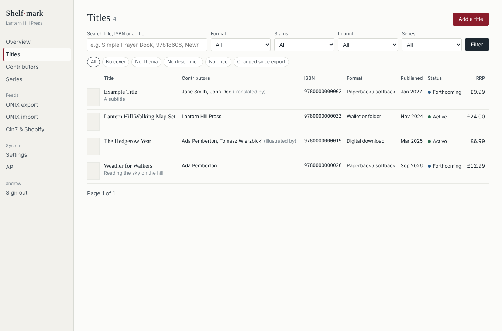

# MOGO

**Self-hosted title metadata management and ONIX 3.0 feeds for small publishers.**

MOGO is the system of record for a publisher's catalogue: one record per product (print,
ebook, audio, non-book), with contributors, subjects, prices, descriptions, covers and
related-format links. It imports ONIX from the system you use now, lets your team edit titles in a
browser, and exports schema-valid ONIX 3.0 to Nielsen, Bowker, Gardners, Ingram or anyone else —
plus connectors to Cin7 Core and Shopify so stock and prices don't drift.

It is built for presses with one to twenty staff: a single Python process, a SQLite file, no
JavaScript build, no external services. It runs on a laptop, a £5/month VPS, or in Docker, and the
whole thing backs up by copying one folder.



## Features

* **ONIX 3.0 import** — short or reference tags; streams large files; re-import updates in place.
  Migrate from Stison, Firebrand, Consonance, Bibliocloud, Nielsen Title Editor or any ONIX source.
* **CSV import/export** — for publishers coming from a spreadsheet. Download the template, fill it in,
  upload.
* **Full ONIX data model** — identifiers, measures, product form details, series/collections,
  contributors with name parts and ISNIs, languages, extents, Thema/BIC/BISAC/keyword/proprietary
  subjects, audiences, descriptions and quotes, cover images, publisher/imprint, dates, copyright,
  sales rights, related works and products, suppliers, prices with tax composites.
* **Editing UI** — searchable title ledger, gap filters (no cover / no Thema / no description /
  no price), per-title editing with full change history, add-title with ISBN check-digit validation.
* **ONIX 3.0 export** — reference or short tags, full or "changed since last export" delta, limited
  to selected formats. Every export is validated against the EDItEUR schema before it is saved.
* **Cover storage** — one click downloads remotely-hosted jackets into local storage so your feed
  no longer depends on a previous vendor's server.
* **Cin7 Core and Shopify connectors** — match by barcode = ISBN; pull stock/price snapshots; push
  title, description and RRP (dry-run by default; new Shopify products are created as drafts).
* **Subject picker** — on each title, search Thema, BIC or BISAC by words or by the start of a code;
  results show the code, heading, its parents and how many of your titles already use it. Codes on
  imported titles are learned automatically; load the official Thema or BIC list (JSON, XML or CSV)
  in Settings for the full scheme. Thema qualifiers are filed under the correct ONIX scheme.
* **Users and roles** — viewer (read-only), editor (titles, imports, feeds) and admin (users,
  settings, recipients, connectors). Role changes and deactivation apply on the next request; the
  last admin cannot be removed; everyone can change their own password; the change history records
  who made each edit. Optional API key for the read-only JSON API.
* **Tax and currency are settings** — UK zero-rated books with 20% standard rate by default;
  change the rates, codes and currency for Ireland, Germany, the US or anywhere else.

## Quick start

Requires Python 3.11+.

```bash
git clone https://github.com/<you>/mogo.git
cd mogo
./run.sh
```

Open http://localhost:8000, complete the two-minute setup page, then import an ONIX file
(or `examples/sample_onix30.xml` to look around).

Docker:

```bash
docker build -t mogo .
docker run -d -p 8000:8000 -v $PWD/data:/srv/data -e SECRET_KEY=$(openssl rand -hex 32) mogo
```

Environment variables: `SECRET_KEY` (set it in production), `MOGO_DATA_DIR` (default `./data`),
`DATABASE_URL` (default SQLite; a Postgres URL works unchanged).

## Going live

1. Put it behind HTTPS (Caddy: `books.example.org { reverse_proxy localhost:8000 }`).
2. **Settings → Media base URL**: your public address, so exported cover links point at you.
3. **Settings → ONIX sender**: contact name and email for the ONIX header.
4. Send your first export to each recipient as a **full** feed, then deltas.
5. Back up the `data/` folder (database + covers + exports).

## Project layout

```
app/
  main.py          FastAPI app, auth and session middleware
  models.py        SQLAlchemy models — one class per ONIX composite, plus users, settings, logs
  web.py           HTML routes       api.py   JSON API        auth.py   login, PBKDF2, API key
  services.py      queries, settings, change log, price/tax helper
  csvio.py         CSV import/export      media.py   cover download/upload
  onix/importer.py, exporter.py, codelists.py, data/
  connectors/cin7.py, shopify.py
  templates/, static/app.css
examples/sample_onix30.xml      fictional four-title catalogue
tests/test_roundtrip.py         import → export → validate → re-import → diff
```

## Design notes

* `RecordReference` defaults to the ISBN-13 but is its own column, so an ISBN correction does not
  orphan the record at recipients.
* `Product.updated_at` moves only when a real metadata change is logged; "changed since last export"
  is therefore reliable.
* Descriptions are stored as entered; on export, HTML is sanitised to the ONIX XHTML subset.
* Code lists and the short↔reference tag map are generated from the EDItEUR schema files shipped
  with the `onixcheck` package. ONIX is a standard of EDItEUR; see https://www.editeur.org/ for the
  specification and licence terms of the schemas and code lists.

## Roadmap

SFTP delivery to recipients · per-recipient profiles · ONIX 2.1 output · sign-in with Microsoft or Google ·
nightly stock sync that sets availability · WooCommerce connector · multi-language UI.
See [CONTRIBUTING.md](CONTRIBUTING.md).

## Licence

MIT. MOGO was built by Taurnez at a small UK publishing house to replace a commercial title
database; it is released so that other small publishers don't have to pay for one.
